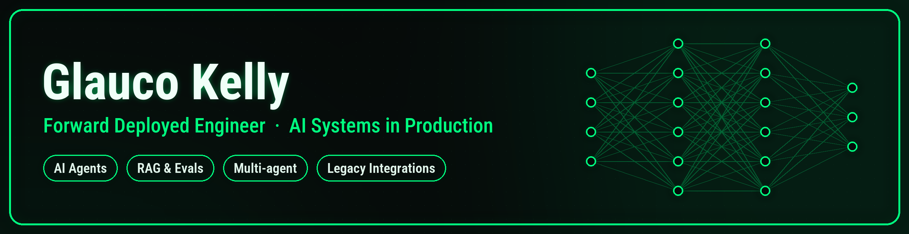

  

  
  &nbsp;
  

## Sobre

Construo sistemas de IA que rodam em produção dentro da operação de empresas: agentes, retrieval, avaliação e integração com sistemas legados. Meu trabalho começa no problema de negócio e termina com o sistema sendo usado no dia a dia.

---

## 🔭 O que venho construindo

> Projetos de clientes são privados. Abaixo, a arquitetura e o resultado, sem dados nem nomes.

**Product matching agêntico para varejo**
Pipeline multimodal que interpreta listas não estruturadas e resolve cada item contra um catálogo de 285 mil SKUs com retrieval híbrido (vetorial + determinístico), taxonomia e enriquecimento por LLM, memória histórica e roteamento por confiança com human-in-the-loop. Eval-driven: **95% de precisão** nos matches automáticos e cadastro de cada lista de **30 para 5 minutos**.

**Operação de marketing multiagente**
Agent harness no padrão orchestrator-worker em que agentes autônomos produzem carrosséis, motion design com voz clonada, cortes e edição de podcast e edição de aulas, com avaliação automática de qualidade antes da entrega.

**Agente de dados para a liderança**
Conversational analytics em tempo real com tool calling sobre uma camada semântica de métricas governadas, respondendo por texto, áudio ou gráficos, com guardrails contra alucinação.

**Automação financeira e fiscal**
Conciliação multiadquirente integrada a ERP legado, com straight-through processing e exception handling, e ingestão automatizada de NF-e.

---

## 🎓 Projetos acadêmicos (FIAP)

### [ChargeGrid Intelligence](https://github.com/STIG4-Solutions/chargegrid-challenge)
Challenge FIAP × GoodWe: um carregador de veículos elétricos vira posto comercial operado por software. Controle de demanda via Modbus, precificação dinâmica pela folga de potência, previsão de demanda com seleção de preditor por backtest, API, painel do operador e app do motorista.

`Python` `FastAPI` `PostgreSQL` `React` `React Native` `LightGBM`

### [Assistente RAG avaliado](https://github.com/STIG4-Solutions/chatbot_sprint4_challenge2026) → [Agente ReAct](https://github.com/STIG4-Solutions/ckp03-agente-chargegrid)
Assistente para operadores de eletropostos que só responde com base em regulação e documentação técnica, citando documento e página; evoluído para agente com tool calling. **Faithfulness 0,22 → 0,76** e **citação com fonte 0% → 100%** (RAGAS).

`LangChain` `ChromaDB` `Busca híbrida + reranking` `RAGAS` `Gradio`

### [Mission Control AI](https://github.com/FIAP-GS-01-2026/mission-control-ai)
Monitoramento de satélites GNSS com IA generativa: telemetria, regras de decisão, memória de contexto e CLI conversacional.

`Python` `LLM open-weight` `Few-shot prompting`

---

## 🧪 Laboratório pessoal

- **Ditado local**: ditado por voz 100% local no macOS, com pós-processamento por LLM, substituindo ferramentas pagas.
- **Assistente de voz**: protótipo com wake word, transcrição local e resposta em streaming (arquivado por custo de operação).
- **Segundo cérebro**: base de conhecimento em Markdown integrada ao fluxo de trabalho com agentes.

---

## 🛠️ Stack

  

`LLMs (Claude, OpenAI, Gemini, open-weight)` `Agentes e tool calling` `RAG e evals` `Busca vetorial` `MCP` `Orquestração de workflows` `Integração de APIs e ERPs`
